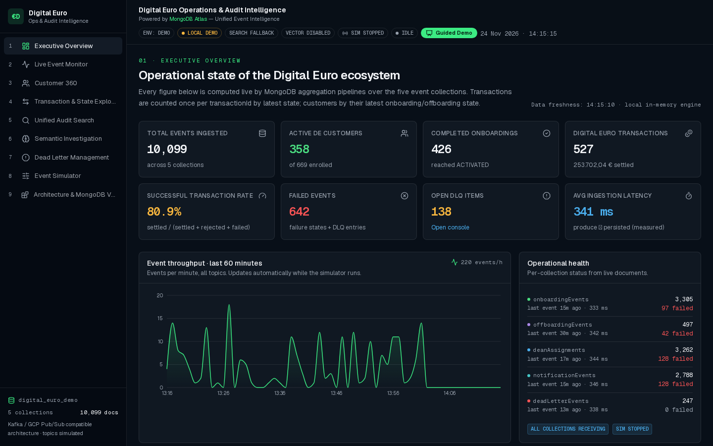
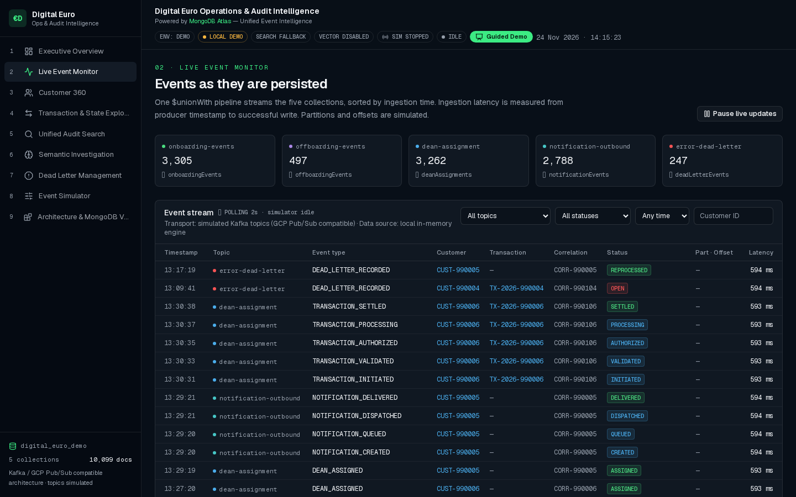
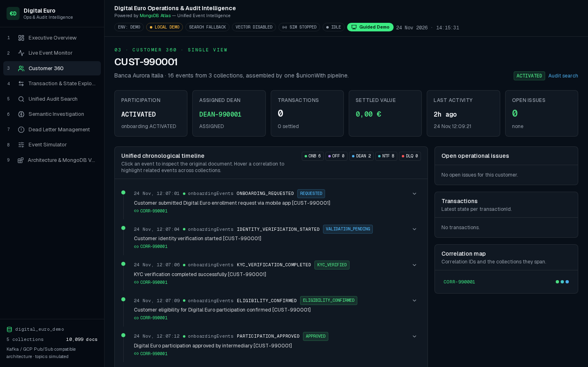
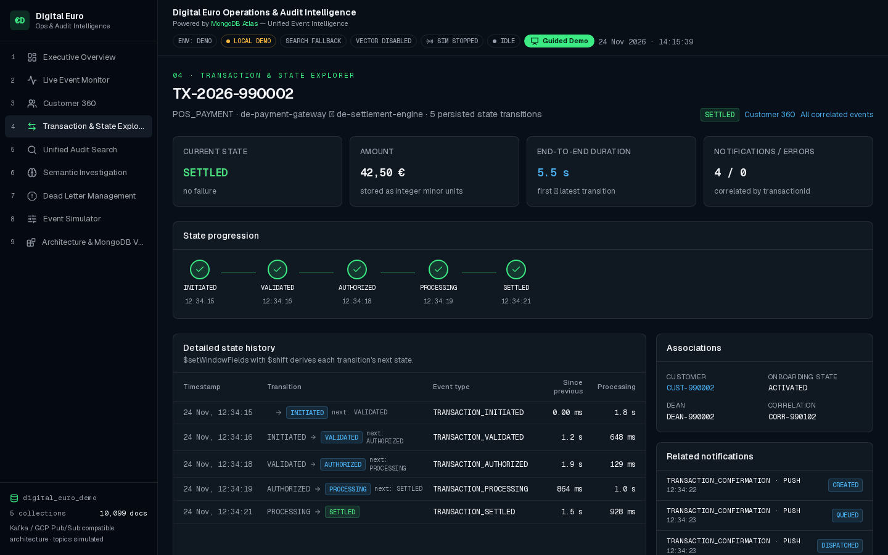
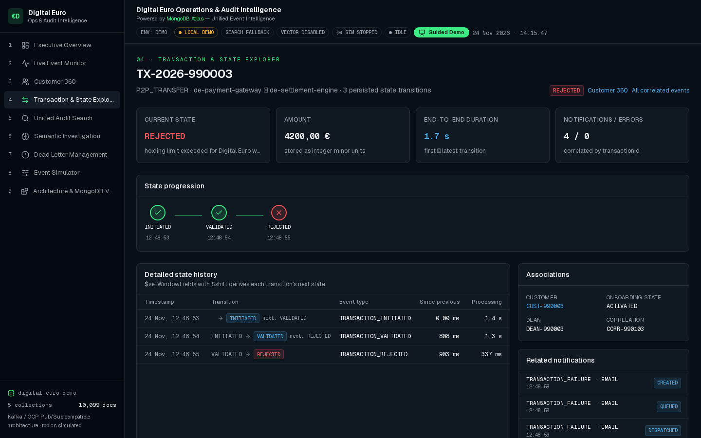
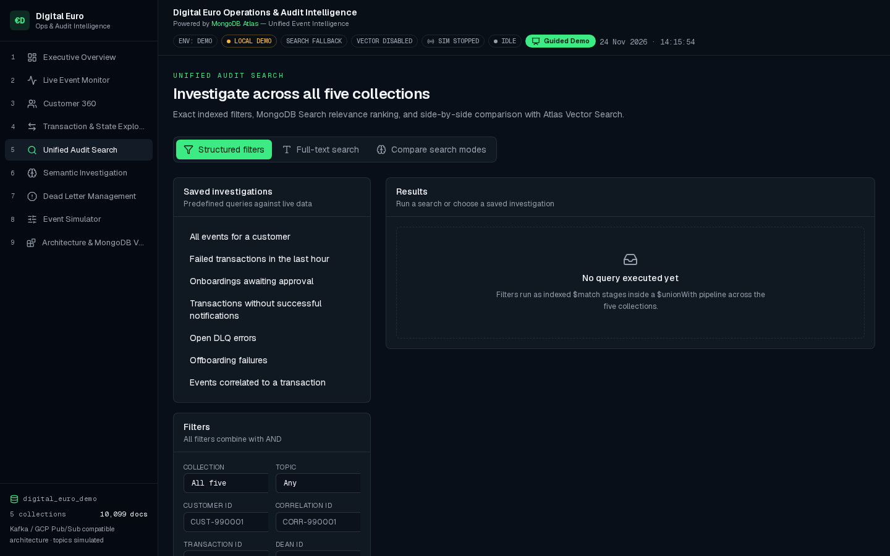
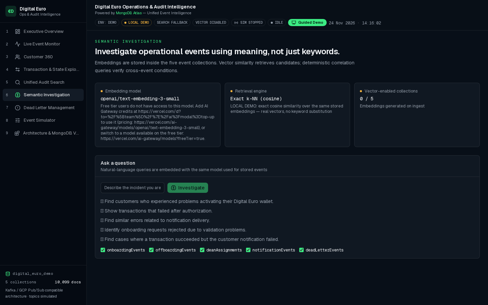
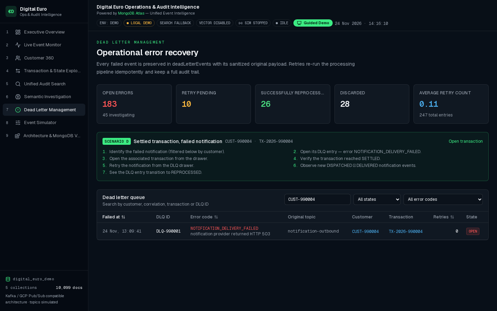
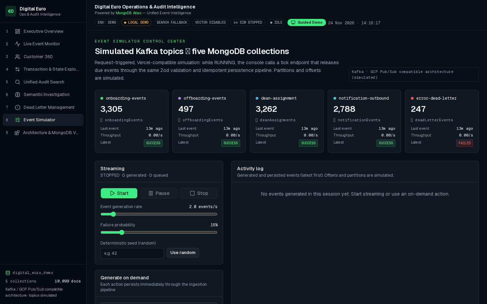
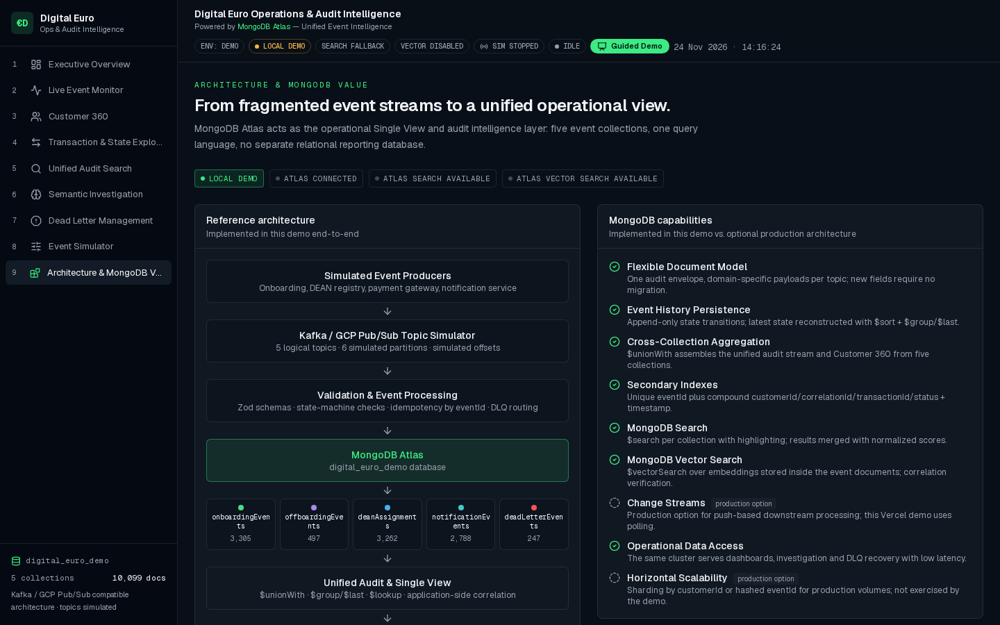

# Digital Euro | Operations & Audit Intelligence

Powered by MongoDB Atlas — Unified Event Intelligence.

## Overview

A Next.js demo that uses MongoDB Atlas as the operational Single View and unified audit layer for a simulated Digital Euro event-driven architecture. Five simulated Kafka topics (GCP Pub/Sub compatible architecture) map to exactly five MongoDB collections:

| Simulated topic | Collection |
|---|---|
| onboarding-events | onboardingEvents |
| offboarding-events | offboardingEvents |
| dean-assignment | deanAssignments |
| notification-outbound | notificationEvents |
| error-dead-letter | deadLetterEvents |

No customer, transaction, vector or materialized-view collection exists. Customer 360, transaction timelines and the unified audit stream are assembled with `$unionWith`, `$group`/`$last` and application-side correlation.

Demo Hub metadata (MongoDB Demo Hub standard v1.0) lives in [`demo-hub/`](demo-hub/):

- [`demo-hub/manifest.json`](demo-hub/manifest.json): catalog metadata, capabilities with evidence, and configuration
- [`demo-hub/architecture.md`](demo-hub/architecture.md): components, data flow, collections and indexes
- [`demo-hub/diagrams/architecture.mmd`](demo-hub/diagrams/architecture.mmd): Mermaid architecture diagram

## Features

- **Executive Overview.** KPIs and charts computed from the five collections, with unique transactions counted by latest state.
- **Live Event Monitor.** Auto-refreshing event table with filters, a JSON viewer and correlated timelines.
- **Customer 360.** One chronological timeline across all five collections, with each event tagged by its source collection.
- **Transaction & State Explorer.** Full state history with previous and next state (`$setWindowFields`), related notifications and errors.
- **Unified Audit Search.** Combined structured filters, pagination and saved investigations.
- **Full-text search.** `$search` per collection with highlighting, plus a clearly labeled fallback.
- **Semantic Investigation.** `$vectorSearch` over real embeddings, with deterministic correlation checks.
- **Dead Letter Management.** Inspect, investigate, retry (re-runs ingestion) and discard, with a retry audit trail.
- **Event Simulator.** Request-triggered generation for five simulated topics, deterministic scenarios, and Reset and Seed.
- **Guided Demo** and an **Architecture & MongoDB Value** page.

## Screenshots

These were captured from the running application in **LOCAL DEMO** mode (seeded dataset, 1440×900). They're stored in [`demo-hub/screenshots/`](demo-hub/screenshots).

| | |
|---|---|
| **Executive Overview**  | **Live Event Monitor**  |
| **Customer 360 (Scenario A)**  | **Transaction Explorer (Scenario B)**  |
| **Rejected transaction (Scenario C)**  | **Unified Audit Search**  |
| **Semantic Investigation**  | **Dead Letter Management (Scenario D)**  |
| **Event Simulator**  | **Architecture & MongoDB Value**  |

## Modes

| Badge | Meaning |
|---|---|
| LOCAL DEMO | No `MONGODB_URI`. An in-memory engine runs the **same aggregation pipelines** (via mingo) over a deterministic ~10,000-document seed. Resets on cold start. |
| ATLAS CONNECTED | `MONGODB_URI` is set. All reads and writes go to the five Atlas collections in `MONGODB_DATABASE`. |
| ATLAS SEARCH AVAILABLE | The `de_text` Search index exists. Full-text search uses `$search` per collection, merged with normalized scores. Otherwise a clearly labeled keyword fallback is used. |
| ATLAS VECTOR SEARCH AVAILABLE | The `de_vector` index exists, and semantic search uses `$vectorSearch`. In local mode, exact cosine k-NN runs over the same real embeddings. If embeddings cannot be generated, vector search is turned off with an explanation. Keyword matching is never presented as vector search. |

## Prerequisites

- **Node.js 20.9 or later** (Next.js 16 requirement; Node 22 or 24 LTS recommended). Check with `node -v`.
- **pnpm**. The repo pins pnpm through the `packageManager` field in `package.json`, so the simplest option is Corepack, which ships with Node:
  ```bash
  corepack enable
  ```
  Alternatively, install pnpm globally:
  ```bash
  npm install -g pnpm
  ```
- **Git**, to clone the repository.
- Optional: a **MongoDB Atlas** cluster (for ATLAS CONNECTED mode) and a **Vercel AI Gateway** key (for semantic search).

## Installation

Either download the ZIP from v0 (three-dot menu → Download ZIP) and unzip it, or clone the repository:

```bash
git clone https://github.com/bobbertonno/digital-euro-audit-layer.git
cd digital-euro-audit-layer
```

Install dependencies:

```bash
pnpm install
```

## Configuration

### Environment variables

| Variable | Required | Notes |
|---|---|---|
| `MONGODB_URI` | for Atlas | Atlas connection string. Server-side only. |
| `MONGODB_DATABASE` | no | Defaults to `digital_euro_demo`. Reset only touches the five collections in this database, and refuses any database whose name does not contain `demo`. |
| `DEMO_MODE` | no | `true` (default) labels the environment DEMO. |
| `DEMO_ADMIN_TOKEN` | public deployments | When set, simulator, DLQ and admin mutations require the header `x-demo-admin-token`. Enter it once on the Event Simulator page. |
| `AI_GATEWAY_API_KEY` | for vector search locally | Embeddings are generated through Vercel AI Gateway. On Vercel, authentication is automatic (OIDC). On a local machine, provide a key or pull the OIDC token (see below). The gateway's embedding models need paid credits. |
| `EMBEDDING_MODEL` | no | Defaults to `openai/text-embedding-3-small`. |
| `EMBEDDING_DIMENSIONS` | no | Defaults to `256`. Must match the `numDimensions` of the Atlas vector index. If you change it, re-seed and re-create the indexes. |
| `ATLAS_SEARCH_INDEX` | no | Defaults to `de_text`. |
| `ATLAS_VECTOR_INDEX` | no | Defaults to `de_vector`. |

### `.env.local`

Create a file named `.env.local` in the project root. Next.js loads it automatically. It is git-ignored and never sent to the browser.

**Option A: LOCAL DEMO (no external services).** You can skip the file entirely, or create it with:

```bash
DEMO_MODE=true
```

**Option B: ATLAS CONNECTED.**

```bash
MONGODB_URI="mongodb+srv://<user>:<password>@<cluster>.mongodb.net/?retryWrites=true&w=majority"
MONGODB_DATABASE=digital_euro_demo
DEMO_MODE=true
# Optional: protect mutating controls even locally
# DEMO_ADMIN_TOKEN=choose-a-long-random-string
```

**Optional: enable semantic (vector) search locally.** Add one of the following:

```bash
# a) An AI Gateway API key (Vercel dashboard → AI Gateway → API Keys)
AI_GATEWAY_API_KEY=your-key
```

or, if the project is linked to Vercel, pull a short-lived OIDC token instead of using a key:

```bash
npm i -g vercel
vercel link
vercel env pull .env.local   # writes VERCEL_OIDC_TOKEN (expires after ~12h; re-run to refresh)
```

Note: `vercel env pull` overwrites `.env.local`, so re-add any variables you wrote by hand (or pull first, then append them).

Without embedding credentials the app still runs. The Semantic Investigation page shows vector search as turned off, with the reason, and never substitutes keyword matching.

## Running locally

Start the development server:

```bash
pnpm dev
```

Open http://localhost:3000. It redirects to **Executive Overview**.

- **LOCAL DEMO:** the deterministic ~10,000-document seed loads into memory on the first request (a few seconds). Data resets whenever the dev server restarts.
- **ATLAS CONNECTED:** see [Running against MongoDB Atlas](#running-against-mongodb-atlas) to seed the collections and create indexes.

The header badges show which mode is active (LOCAL DEMO / ATLAS CONNECTED / ATLAS SEARCH AVAILABLE / ATLAS VECTOR SEARCH AVAILABLE). The health endpoint returns the same information as JSON:

```bash
curl http://localhost:3000/api/health
```

To run the optimized production build locally:

```bash
pnpm build
pnpm start
```

This also serves on http://localhost:3000. To use a different port:

```bash
pnpm dev -p 4000
# or
pnpm start -p 4000
```

### Quick smoke test

1. **Executive Overview** shows non-zero KPIs and charts.
2. Click **Event Simulator → Start simulation**, then switch to **Live Event Monitor** and watch new rows arrive. Keep a browser tab open, because ticks are driven by the open console.
3. **Guided Demo** (in the header) walks through all five presenter steps, including the Scenario D notification retry on **Dead Letter Management**.

## Running against MongoDB Atlas

1. Create an Atlas cluster. M10+ is recommended for Search and Vector Search; M0 works for structured queries.
2. In Atlas, make sure that:
   - your machine's IP address is allowed under **Network Access** (or temporarily allow `0.0.0.0/0` for a demo cluster);
   - the database user in the URI has `readWrite` on `MONGODB_DATABASE`, plus `dbAdmin` so the app can create search indexes.
3. Set `MONGODB_URI` (and optionally `MONGODB_DATABASE`) in `.env.local` for local runs, or in Vercel → Project → Settings → Environment Variables for deployments. Restart `pnpm dev` after editing env files.
4. The collections start empty. Open **Event Simulator → Reset and Seed Demo** and confirm. The console seeds in bounded batches (`/api/admin` `seed-batch`), so no single serverless request exceeds time limits. Wait for the batch progress to finish.
5. Click **Ensure indexes**. This creates:
   - a unique `eventId` index per collection; `customerId+timestamp`, `correlationId+timestamp`, `transactionId+timestamp`, `eventType+timestamp`, `status+timestamp`, `payload.errorCode+timestamp`, `ingestedAt`
   - a `de_text` MongoDB Search index per collection
   - a `de_vector` Vector Search index per collection, with `numDimensions` taken from `EMBEDDING_DIMENSIONS`
6. Search indexes build asynchronously. The header badges update once Atlas reports them as queryable. Data persists across restarts.

## Troubleshooting

| Symptom | Fix |
|---|---|
| `pnpm: command not found` | Run `corepack enable`, or `npm install -g pnpm`. |
| Corepack reports a pnpm version error | Run `corepack prepare pnpm@latest --activate`, or install pnpm globally and run `pnpm install` again. |
| `Port 3000 is in use` | Next.js picks the next free port automatically. Use the URL printed in the terminal, or stop the other process. |
| Header shows LOCAL DEMO although `MONGODB_URI` is set | The variable must be in `.env.local` in the project root. Restart `pnpm dev` after editing env files. |
| `MongoServerSelectionError` / connection timeout | Your IP is not on the Atlas Network Access list, or a VPN or firewall blocks port 27017. |
| `bad auth` / authentication failed | Check the username and password in the URI. URL-encode special characters in the password. |
| Full-text search shows "keyword fallback" | The Atlas Search indexes are still building, or **Ensure indexes** was not run. Wait until the header badge turns on. |
| Vector search turned off with an auth or credits message | Set `AI_GATEWAY_API_KEY`, or refresh the OIDC token with `vercel env pull`. Make sure the AI Gateway account has credits. |
| Simulator buttons return 401 | `DEMO_ADMIN_TOKEN` is set. Enter the same value on the Event Simulator page. |
| Reset refuses to run | `MONGODB_DATABASE` must contain `demo` (for example `digital_euro_demo`). |

## Deploying to Vercel

Click **Publish** in v0, or push to GitHub and import the repository in Vercel. Set `DEMO_ADMIN_TOKEN` on any public deployment.

## Simulation model

Vercel functions cannot run persistent intervals. While the simulator is RUNNING, the open console calls `/api/simulator/tick`. Each tick releases the events that are due at the configured rate, and they go through the same pipeline as all other events: Zod validation → state-transition check → idempotent persistence. Partitions and offsets are simulated and labeled as such. Ingestion latency is measured from event creation to the confirmed database write. Autonomous 24/7 streaming would need an external worker or a managed scheduler. In production, real Kafka/Pub/Sub consumers would replace the simulator, and Change Streams could replace polling.

## Showcase scenarios (stable IDs)

| | Scenario | Customer |
|---|---|---|
| A | Successful onboarding and DEAN assignment | CUST-990001 |
| B | Successful transaction with notification | CUST-990002 |
| C | Transaction rejected after validation | CUST-990003 |
| D | Settled transaction, failed notification → DLQ retry | CUST-990004 |
| E | Invalid event routed to DLQ and reprocessed | CUST-990005 |
| F | Offboarding blocked by outstanding balance | CUST-990006 |

Use **Guided Demo** in the header for the five-step presenter walkthrough.

## Not claimed

This demo does not provide regulatory compliance, exactly-once delivery or production SLAs, and it does not define DEAN authoritatively. All data is fictional. Monetary values are stored as integer EUR minor units.
